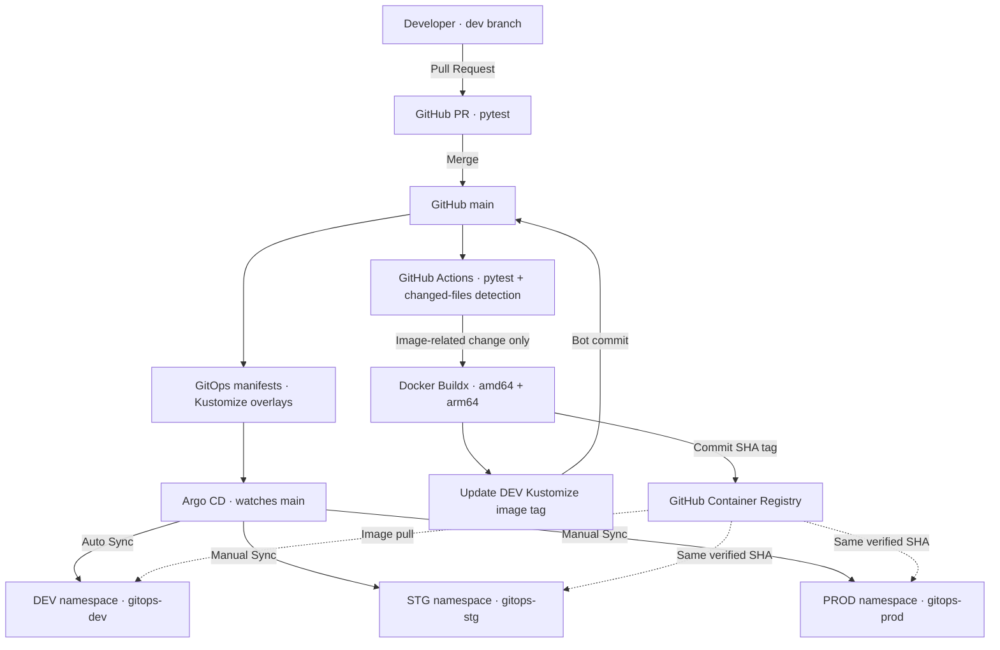
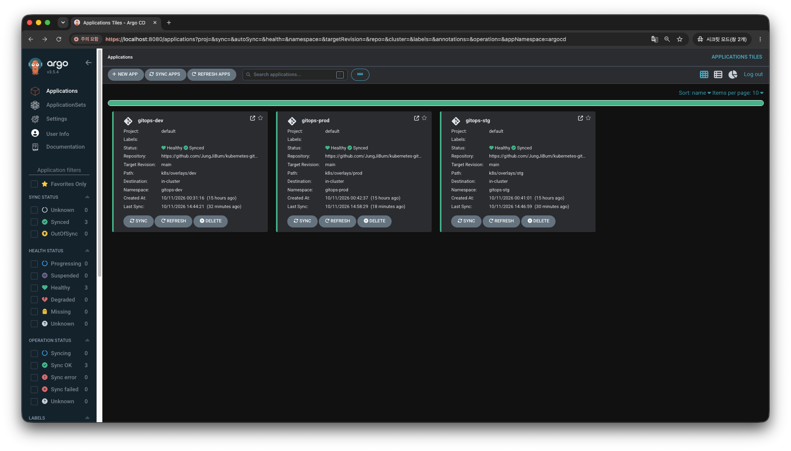
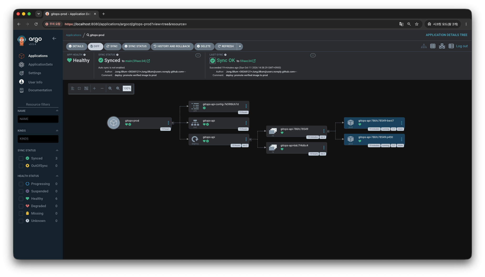
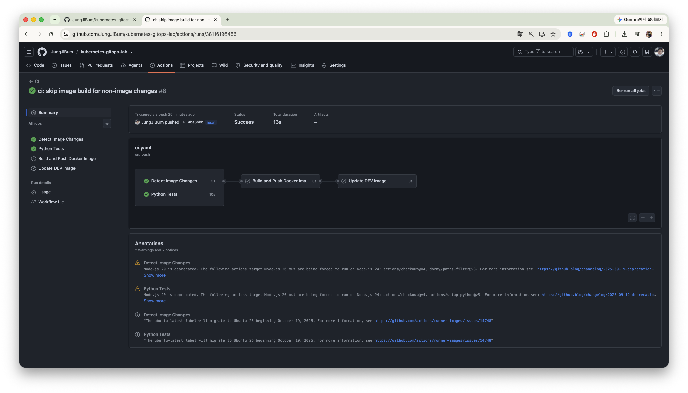

# Kubernetes GitOps Lab

**FastAPI · Docker · GitHub Actions · GHCR · Kubernetes (kind) · Kustomize · Argo CD**

FastAPI 애플리케이션을 대상으로 **코드 변경 → CI 테스트 → 컨테이너 이미지 빌드 → DEV 자동 배포 → STG/PROD 수동 승격**을 직접 구축하고 검증한 GitOps 실습 프로젝트입니다.

핵심은 CI와 CD를 분리하고, 환경별로 **자동 배포와 승인 후 배포를 구분**하는 것입니다. 로컬 kind 클러스터에서 검증했으며, 실제 클라우드 프로덕션 운영을 의미하지 않습니다.

## 아키텍처



- **CI:** GitHub Actions가 테스트, 이미지 변경 감지, 멀티 아키텍처 빌드, GHCR Push, DEV 이미지 태그 갱신을 담당합니다.
- **CD:** Argo CD가 Git의 Kustomize 매니페스트와 클러스터 상태를 비교합니다.
- **환경 승격:** DEV에서 검증한 **동일한 이미지 SHA**를 STG와 PROD Overlay에 지정하고, 각 환경에서 수동 Sync합니다. STG/PROD 승격은 새로운 이미지를 다시 빌드하는 과정이 아닙니다.

## 기술 스택

| 구분 | 기술 |
| --- | --- |
| API / Test | Python 3.12, FastAPI, pytest |
| Container | Docker, Docker Compose, Docker Buildx |
| Registry | GHCR (GitHub Container Registry) |
| CI | GitHub Actions, `dorny/paths-filter` |
| Kubernetes | kind, kubectl, Deployment, Service, Probe |
| GitOps | Kustomize, Argo CD |

## 배포 정책

| 환경 | Namespace | 배포 정책 | 이미지 태그 관리 | 로컬 포트 |
| --- | --- | --- | --- | --- |
| DEV | `gitops-dev` | Argo CD **자동 Sync** | CI가 Commit SHA로 갱신 | `8082` |
| STG | `gitops-stg` | Argo CD **수동 Sync** | 검증한 SHA로 수동 승격 | `8084` |
| PROD | `gitops-prod` | Argo CD **수동 Sync** | STG와 동일한 SHA로 수동 승격 | `8085` |

STG는 Replica 1개, PROD는 Replica 2개로 구성했습니다. Argo CD의 `OutOfSync`는 **Git에서 원하는 상태와 실제 클러스터 상태가 다르다**는 의미이며, 수동 Sync가 꺼져 있는 환경에서는 이를 감지해도 실제 배포는 진행되지 않습니다.

### 개발부터 운영까지

1. `dev` 브랜치에서 개발하고 `main`으로 PR을 생성합니다. PR에서는 Python 테스트를 수행합니다.
2. `main` Merge 시 테스트를 수행하고, 이미지 관련 파일이 변경되었다면 Docker 이미지를 빌드해 GHCR에 Commit SHA 태그로 Push합니다.
3. CI가 `k8s/overlays/dev/kustomization.yaml`의 이미지 태그를 갱신해 Git에 반영합니다. DEV는 Argo CD가 자동으로 Sync합니다.
4. DEV에서 검증한 SHA를 STG Overlay에 반영해 Push합니다. Argo CD가 `OutOfSync`를 표시한 뒤 **수동 Sync**하여 검증합니다.
5. STG에서 검증한 **같은 SHA**를 PROD Overlay에 반영하고, 마찬가지로 `OutOfSync` 확인 후 **수동 Sync**합니다.

> 이 실습에서는 환경 승격용 Kustomize 변경을 `main`에 직접 커밋했습니다. 향후 승격 PR 및 브랜치 보호 규칙을 추가할 수 있습니다.

## CI: 불필요한 이미지 빌드 방지

워크플로: [`.github/workflows/ci.yaml`](.github/workflows/ci.yaml)

Docker 이미지 빌드는 다음 경로가 변경된 `main` Push에서만 실행하도록 변경 파일 감지 조건을 추가했습니다.

```text
app/**
Dockerfile
requirements.txt
```

- PR: Python Tests 수행, Docker Build 및 DEV 태그 갱신 생략
- `main`의 이미지 관련 변경: Python Tests → Build/Push → DEV 태그 갱신
- README, STG/PROD Overlay 등의 변경: Python Tests 수행, **Build/Push 및 DEV 태그 갱신 Skip**

실제 워크플로 설정만 수정한 Push에서 **Detect Image Changes / Python Tests는 성공**, **Build and Push Docker Image / Update DEV Image는 Skipped**인 것을 확인했습니다.

> 참고: 이미지 빌드가 생략되어도 `k8s/overlays/dev` 자체가 변경되면 Argo CD DEV의 자동 Sync는 별도로 발생할 수 있습니다. `tests/**`만 변경해도 테스트는 수행하지만 이미지는 다시 빌드하지 않습니다.

## Kubernetes 매니페스트

```text
k8s/
├── base/
│   ├── deployment.yaml
│   ├── service.yaml
│   └── kustomization.yaml
└── overlays/
    ├── dev/kustomization.yaml
    ├── stg/kustomization.yaml
    └── prod/kustomization.yaml
```

공통 Deployment/Service는 Base에 두고, 환경별 이미지 태그·환경변수·Replica 등은 Overlay로 분리했습니다.

```bash
kubectl kustomize k8s/overlays/dev
kubectl kustomize k8s/overlays/stg
kubectl kustomize k8s/overlays/prod
```

## 실제 검증 결과

### DEV — 자동 배포

- `dev` → `main` PR 테스트 통과 후 Merge
- GitHub Actions에서 이미지 빌드 및 GHCR Push 성공
- DEV 이미지 태그 자동 갱신 및 Argo CD 자동 Sync 확인
- Deployment Rollout 및 `http://localhost:8082/web` 페이지 확인

### STG — 수동 승격

- 기존 이미지: `ghcr.io/jungjibum/kubernetes-gitops-lab:v2`
- Sync 전 `/web`: **404 Not Found**
- STG Overlay 변경을 Argo CD가 감지하여 **OutOfSync** 전환
- 수동 Sync 전까지 실제 Deployment는 기존 `v2` 이미지 유지
- Argo CD UI에서 수동 Sync → **Synced / Healthy**, Rollout 성공
- `http://localhost:8084/web` 페이지 표시 확인

### PROD — 수동 승격

- 기존 이미지: `ghcr.io/jungjibum/kubernetes-gitops-lab:v2`
- Sync 전 `/web`: **404 Not Found**
- Git Revision `59aec34e1b8b6c25e24ebe67389f8fd5aee87a61` 감지 후 **OutOfSync** 확인
- 수동 Sync 전까지 기존 `v2` 이미지 유지
- Argo CD UI에서 수동 Sync → **Synced / Healthy**, Rollout 성공
- `http://localhost:8085/web` 페이지 표시 확인

STG와 PROD에 승격한 이미지:

```text
ghcr.io/jungjibum/kubernetes-gitops-lab:ba6268acadd54bc220de54c8db5e452288376c6f
```

### 검증 스크린샷

### Argo CD 환경별 배포 상태



### PROD Rolling Update 결과



### GitHub Actions CI 최적화



## API 및 실행 확인

| Endpoint | 목적 |
| --- | --- |
| `/` | 앱 정보 및 환경 정보 |
| `/health/live` | Liveness Probe |
| `/health/ready` | Readiness Probe |
| `/version` | 버전 확인 |
| `/web` | 배포 확인용 웹 페이지 |

```bash
# 로컬 Docker Compose
docker compose up -d --build
# http://localhost:8000/web

# Kubernetes (각각 별도 터미널에서 실행)
kubectl port-forward -n gitops-dev svc/gitops-api 8082:8000
kubectl port-forward -n gitops-stg svc/gitops-api 8084:8000
kubectl port-forward -n gitops-prod svc/gitops-api 8085:8000

# Argo CD UI
kubectl port-forward -n argocd svc/argocd-server 8080:443
# https://localhost:8080
```

Port Forward는 로컬 실습용 연결이며, Pod Rolling Update 시 기존 연결이 끊길 수 있습니다. 웹 페이지의 `DEV Deployment Verification` 문구는 현재 정적 텍스트이므로, STG/PROD에서도 동일하게 표시됩니다. 실제 환경은 API의 `APP_ENV` 값과 Kubernetes Namespace로 구분합니다.

## 설계 및 검증에서 얻은 점

- **CI/CD 책임 분리:** GitHub Actions는 이미지 생성과 Git 배포 상태 갱신, Argo CD는 Kubernetes 상태 반영을 담당합니다.
- **선언적 배포:** 환경별 Kustomize Overlay를 Git에서 관리해 배포 대상 이미지를 명시합니다.
- **승인 단계의 분리:** STG/PROD는 Git 변경 감지(`OutOfSync`)와 실제 배포(Sync)를 분리해 수동 승격을 검증했습니다.
- **불변 이미지 승격:** STG/PROD에서 이미지를 다시 빌드하지 않고 같은 Commit SHA 태그를 사용했습니다.
- **불필요한 배포 감소:** 이미지와 무관한 변경은 Build/Push 및 DEV 이미지 태그 갱신을 생략합니다.

## 향후 개선

- STG/PROD 승격 PR 및 브랜치 보호 규칙
- `/web`에서 `APP_ENV`와 `APP_VERSION` 동적 표시
- 배포 실패·롤백 시나리오 검증
- Ingress 기반 접근 및 운영 환경 보안·가용성 검토

---

**검증 범위:** macOS Docker Desktop의 로컬 kind 클러스터. 이 프로젝트는 GitOps 배포 흐름을 재현·검증한 포트폴리오 실습이며, 실제 서비스 운영 환경의 고가용성·보안·외부 노출 구성까지 검증한 것은 아닙니다.
